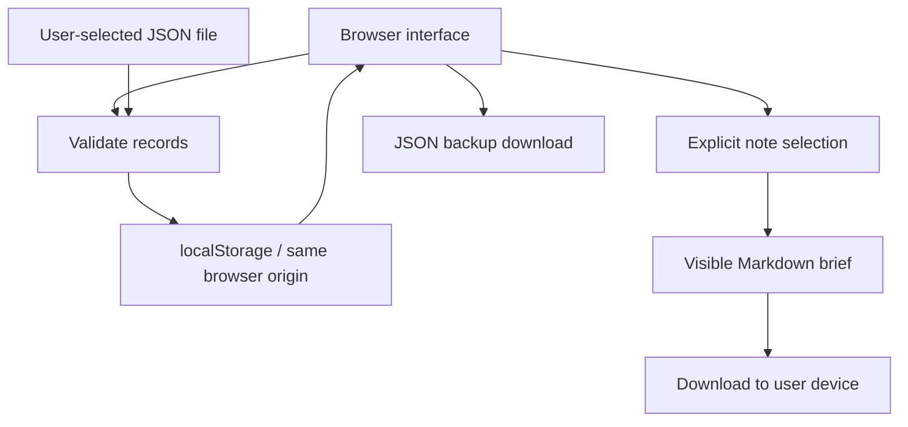

# Architecture

`docs/app.js` owns capture, collection filtering, editing, selection, import and export. `docs/index.html` provides the product story and workspace. `docs/style.css` provides the responsive presentation.

There is no backend, login, AI integration, telemetry SDK or automatic outbound sharing. Static hosting is not a security boundary for localStorage. The user controls downloaded copies and manually chooses whether to share them.

The private knowledge OS inspired the collections and capture/review/reuse model. This repository is a clean public implementation, not a copy of that archive. Classification and team-sync integrations from the private workflow are not implemented here.
