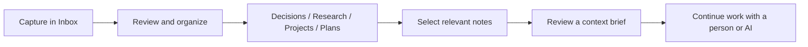

# Kenny OS
### Personal context management. Pick up where your thinking left off.

Kenny OS helps you capture scattered information, preserve the reasoning behind decisions and assemble relevant context for your next work session.

**[Open the interactive starter](https://kennylimkamho.github.io/kenny-os-context/)** · [Explore Kenny’s portfolio](https://github.com/kennylimkamho)

**Status: local-first browser prototype.** This public implementation is newly built from the workflow of Kenny’s private knowledge OS. It contains no personal archive, private repository history, credentials or internal business records. It is not the original private system and does not reproduce its AI integrations.

## The problem

A note can preserve information without preserving usable context. When work resumes in a new session, the missing pieces are often the goal, the decision, the alternatives and the next action.

Kenny OS treats those pieces as something worth maintaining deliberately.



## Try the workflow

1. Open the starter and load the **fictional examples**, or capture your own note.
2. Start in Inbox; review and move useful notes into a collection using Edit.
3. Search for a project or decision.
4. Select **Include in brief** on the relevant notes.
5. Review and download the Markdown context brief. Share it manually only where appropriate.
6. Download a JSON backup to keep the underlying notes.

## Implemented vs. future

| Implemented here | Future product direction |
| --- | --- |
| Capture, edit and delete notes | File and audio ingestion |
| Seven collections and text search | Assisted classification and semantic retrieval |
| Browser storage; JSON backup and restore | Encrypted storage, sync and recovery |
| Explicit selection and Markdown brief export | AI-provider integrations with deliberate permissions |
| Fictional demo records | Team sharing with access controls |

The future column is a direction, not a feature claim. The current app makes no model calls and sends no notes to an application server. GitHub Pages still receives ordinary hosting requests.

## The design behind it

- **Inbox first:** preserve input before deciding where it belongs.
- **Time vs. topic:** a journal records what happened; research records what remains useful.
- **Decisions need reasons:** preserve alternatives and tradeoffs, not just conclusions.
- **Personal and shared context are different:** select and review before sharing. This prototype supports manual export, not enforced organizational access control.
- **Portable context:** Markdown is easy to inspect and bring into another tool.

[Architecture and boundaries](ARCHITECTURE.md) · [Decision template](templates/decision.md) · [Project context template](templates/project.md)

## Run locally

No dependencies or build step. Use Python 3:

```sh
python3 -m http.server 8080 --directory docs
```

Open `http://localhost:8080`. Serve over localhost or HTTPS so the browser UUID API is available.

## Data and limits

Notes are stored in localStorage on the current browser origin. They are **not encrypted, backed up automatically or synchronized**. Anyone using the same browser profile may be able to read them. Clearing site data can remove them. Use fictional or non-sensitive content for a first trial; download backups when keeping work.

Restore replaces the current notebook after confirmation. Imports are validated, capped at 5 MB and 2,000 notes, and rendered as text. Storage limits vary by browser. A failed write is reported without replacing the in-memory notebook.

## Product and technical direction

Kenny’s role is product framing and design direction with AI-assisted implementation. This repository makes that direction inspectable through a working, deliberately small interface. No commercial adoption or productivity improvement is claimed.
